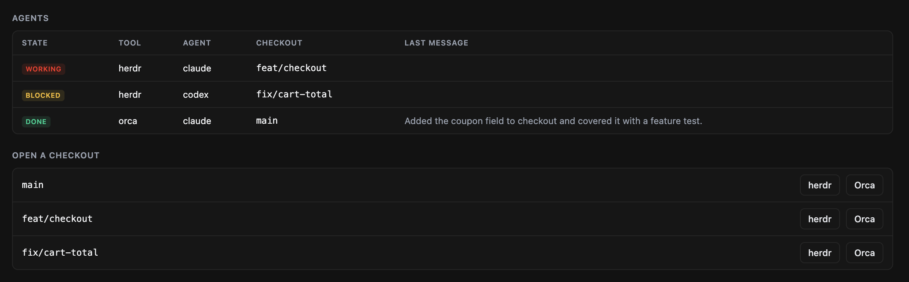

# lerd-agents

A [lerd](https://lerd.sh) plugin that connects lerd sites to the coding agents run by [herdr](https://herdr.dev) and [Orca](https://github.com/stablyai/orca). It works with whichever of the two is running and skips the other.



## What it adds to lerd

- **Site tab "Agents"**: every herdr and Orca agent in the site's checkouts (the main one and each worktree) with its state and last message, refreshed every five seconds, plus a herdr and an Orca button per checkout.
- **Overview card "Agents"**: a count of agents per state, off until switched on for a site.
- **Site commands** in the Commands menu: **Open in herdr** and **Open in Orca**.
- **Commands**: `lerd agents:status [site]` lists the agents in a site; `lerd agents:watch` runs in the foreground and sends a notification when an agent finishes or starts waiting for input.
- **Hooks** on `worktree.added` and `worktree.removed`.
- **MCP tool** `agents_status`, with a skill, so an assistant can see which agents are busy in a site.
- **API endpoints** `status` (read) and `open` (`loopback_only`, used by the tab's buttons).
- **Notifications**, declared in `plugin.yaml`, sent only by `agents:watch`, only when an agent finishes or needs input.

## What it reads, changes and sends

- **Reads**: lerd's `/api/sites` through the token lerd gives it; `git worktree list` and each worktree's `.git` file in the site's own folder; `herdr agent list`, `herdr pane list`, and Orca's `status`, `worktree ps`, `repo list` and `terminal list`. It reads no `.env`, keys or other secrets.
- **Changes**: in herdr, **Open in herdr** and the `worktree.added` hook create a workspace in a checkout (or focus the one already there); `worktree.removed` closes only a workspace the hook created, and leaves it open while an agent in it is working or blocked. In Orca, **Open in Orca** and the hook add the site's repository when Orca does not know it yet and set it to show worktrees Orca did not create; **Open in Orca** also switches to, or creates, a terminal in the checkout. In its own data folder it keeps `herdr-workspaces.json`, the workspaces the hook created. Nothing else is written, and lerd itself is never changed.
- **Sends over the network**: nothing. Every call goes to lerd's local API or to the local `herdr` and `orca` commands.

## Requirements

- lerd 1.38 or newer, `git`, and Node (lerd's own Node works).
- herdr and Orca are optional: the plugin uses each one it finds, on the PATH or where they usually install (`/opt/homebrew/bin`, `/usr/local/bin`, `/usr/bin`, `~/.local/bin`, `~/.cargo/bin`, `/Applications/Orca.app/Contents/Resources/bin`), or at `HERDR_BIN` / `ORCA_BIN`. herdr needs its server running, Orca the app or `orca serve`.
- Orca's CLI is `orca` on macOS and `orca-ide` on Linux, where `/usr/bin/orca` is GNOME's screen reader. On Linux the plugin only looks for `orca-ide` and never runs a bare `orca`, and on either platform it treats a binary as Orca only once `status --json` answers with Orca's JSON.

## Install

```bash
lerd plugin install agents        # once listed in the catalog
lerd plugin notifications agents on
lerd agents:watch                 # keep it running in a herdr or Orca pane for notifications
```

See [DOCS.md](DOCS.md) for each part.

## Develop

```bash
npm test
lerd plugin remove agents && lerd plugin install .
```

## License

MIT
